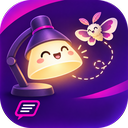
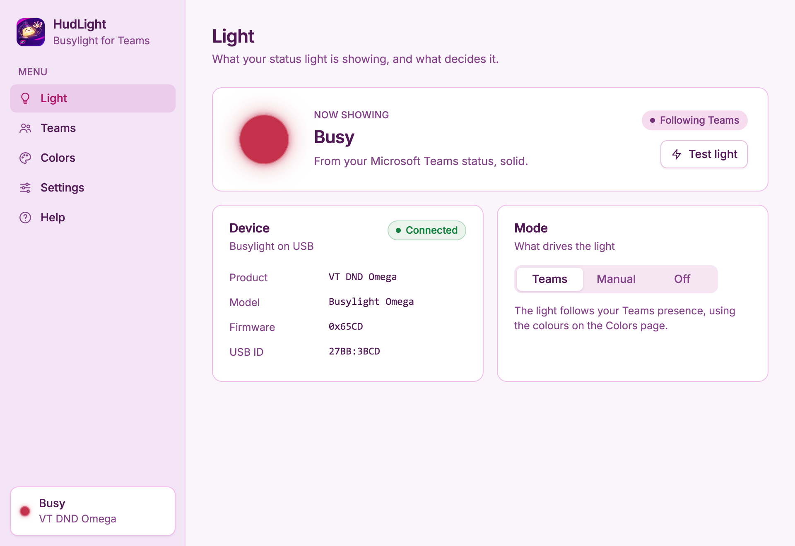
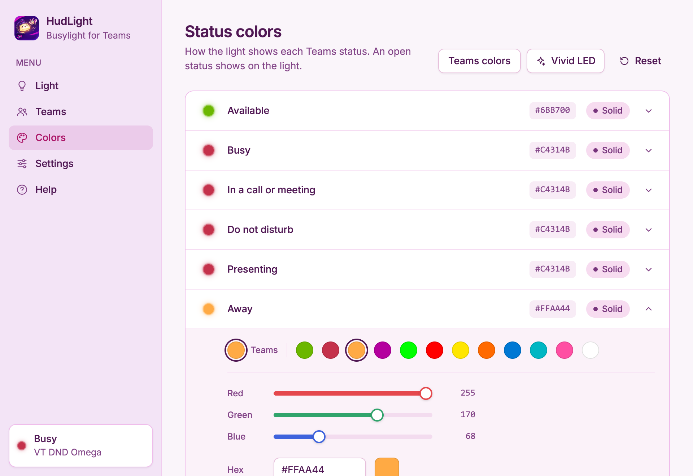
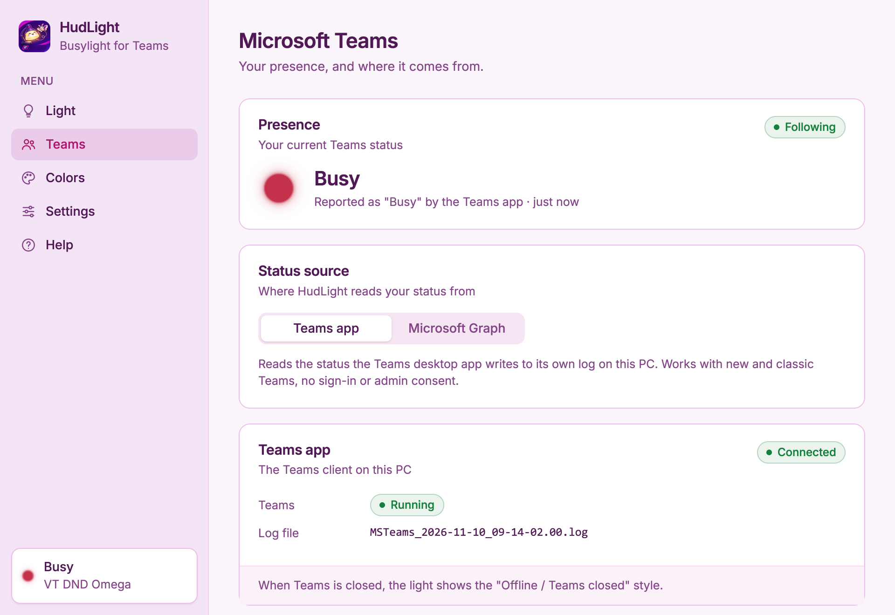
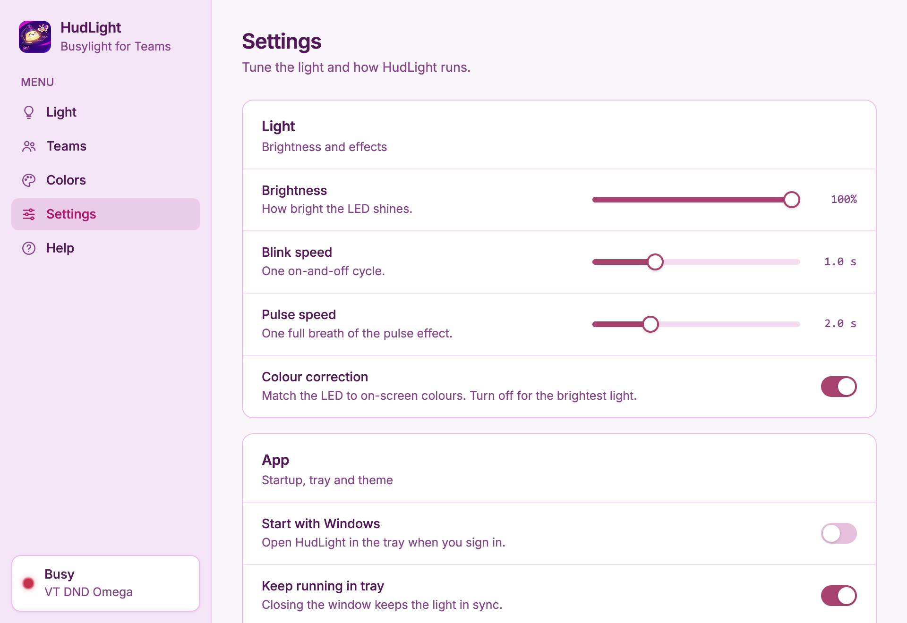
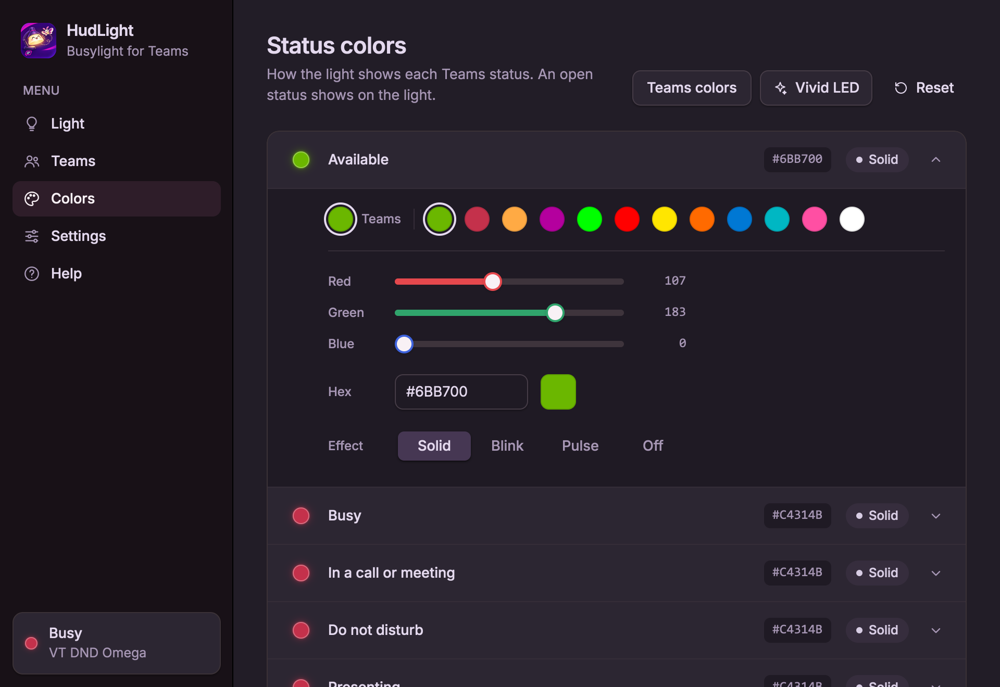

# HudLight



A Windows desktop app for the **VT DND Omega** status light (and other Kuando Busylights) that
follows your **Microsoft Teams** presence and shows it in Teams' own colours. Built with
[Rune](https://github.com/anomalyco/rune), a GPU-rendered Rust UI framework.



## Features

- **Follows Teams.** Available, Busy, In a call or meeting, Do not disturb, Presenting, Away,
  Be right back, Out of office, and Offline/Teams closed each map to a colour and effect.
- **Two presence sources.**
  - *Teams app* (default): reads the status the Teams desktop client writes to its own log on this
    PC. No sign-in, no admin consent. Works with new Teams and classic Teams.
  - *Microsoft Graph*: asks `/me/presence` after a device-code sign-in. Needs your own Entra ID app
    registration (see below). The refresh token is stored encrypted with Windows DPAPI.
- **Customisation.** Per-status colour (preset swatches, RGB sliders, hex) and effect (solid,
  blink, pulse, off). One-click presets: Teams colors, Vivid LED, Reset. While a status is open
  on the Colors page, the light shows it.
- **Modes.** Follow Teams, a manual colour, or off.
- **Light settings.** Brightness, blink and pulse speed, colour correction (gamma).
- **Runs in the tray.** The tray icon shows the current colour; right-click to switch modes or quit.
  Optionally starts with Windows and starts minimized. The light turns off when you quit.
- **Hot-plug.** Lights are found automatically when plugged in; several lights stay in sync.

| Colors | Teams | Settings |
| --- | --- | --- |
|  |  |  |

The look is shadcn/ui-style cards and controls in the [T3 Chat theme](https://tweakcn.com/r/themes/t3-chat.json),
in light and dark (follows Windows, or pick one in Settings).



## Build and run

Requires Rust (stable, edition 2024) and the MSVC build tools.

```powershell
cargo build --release
target\release\hudlight.exe              # opens the window
target\release\hudlight.exe --minimized  # starts in the tray
```

Settings live in `%APPDATA%\HudLight\config.json`. Set `HUDLIGHT_DEBUG=1` to log what the engine
sees (devices, presence, output) to stderr.

## Supported lights

- **VT DND Omega and DND Alpha** (`340B:F001`, `340B:F002`), made by Xiamen VBeT.
- **Kuando Busylights**: Omega, Alpha, UC Alpha and Mini (vendor `27BB`, including VT-rebadged
  ones), and the original Busylight UC (`04D8:F848`).

**VT protocol.** Each command is a 5-byte output report `[01, action, d0, d1, d2]`, where `01` is
the report ID. `04 R G B` sets a colour, `01` turns the light off, and `09 level` sets the
hardware brightness (1–3; HudLight sets 3 and dims in software). There's no blink timer, so
HudLight blinks these lights itself. Commands go out at least 100 ms apart, because the
firmware can drop one sent sooner. No keep-alive is needed.

**Kuando protocol.** Each command is a 64-byte output report of seven 8-byte steps
`[opcode|operand, repeat, red, green, blue, on_time, off_time, audio]` and a footer
`[sensitivity, timeout, trigger, FF, FF, FF, checksum_hi, checksum_lo]`, where the checksum is
the sum of bytes 0–61. A step that jumps to itself (`0x10`) holds a colour; `0x8F` is a keep-alive
with a 15 s timeout, sent every 10 s. See `src/busylight.rs`.

## Microsoft Graph setup

1. In the Entra admin center, register an app (single tenant or multi-tenant).
2. Under **Authentication**, add the *Mobile and desktop applications* platform and turn on
   **Allow public client flows**.
3. Under **API permissions**, add delegated **Presence.Read** and **User.Read**.
4. In HudLight, open **Teams → Status source → Microsoft Graph**, paste the app's client ID
   (and your tenant ID, or leave `organizations`), and press **Sign in**.

## Development

```powershell
cargo test                       # unit tests + headless UI click-through tests
target\debug\hudlight.exe --list-scenes
target\debug\hudlight.exe --snap out.png --scene colors-open --theme light --scale 1
```

Headless runs (Rune's `--snap`, `--tree`, `--script`) render demo data and never touch the light,
Teams or the settings file.

| Path | What |
| --- | --- |
| `src/busylight.rs` | Kuando HID protocol and device discovery |
| `src/teams.rs` | Teams log watcher and Microsoft Graph client |
| `src/engine.rs` | Background threads that drive the light |
| `src/config.rs` | Settings and persistence |
| `src/ui/` | Rune views, tray, and UI tests |

## Caveats

- The Teams client log format isn't documented by Microsoft and may change with a Teams update;
  the Graph source is the fallback.
- macOS and Linux build, but the tray, start-with-Windows and DPAPI parts are Windows-only.
- Colour channels are sent as 0–255, as the open-source Busylight libraries do. If brightness
  stops increasing past roughly 40% on your light, its firmware reads percent instead: set
  `"pwm_100": true` in `config.json` and restart.
